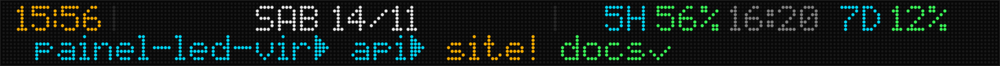
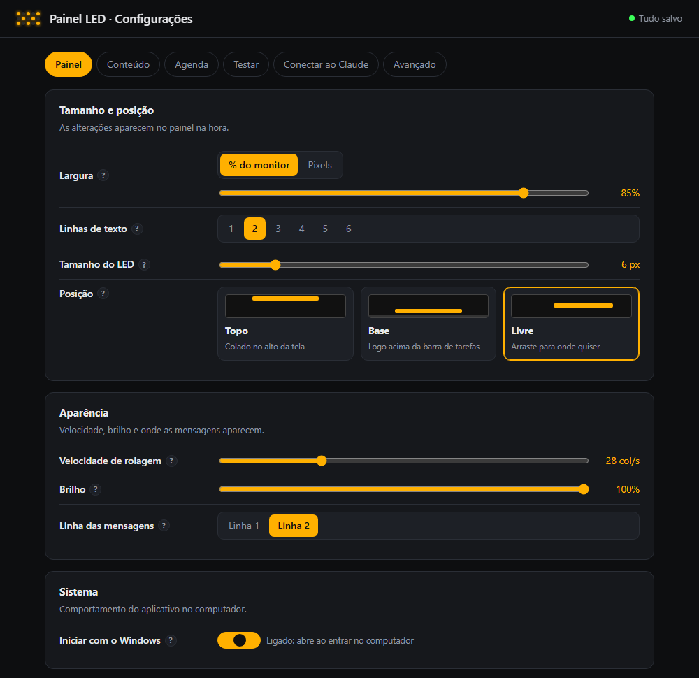
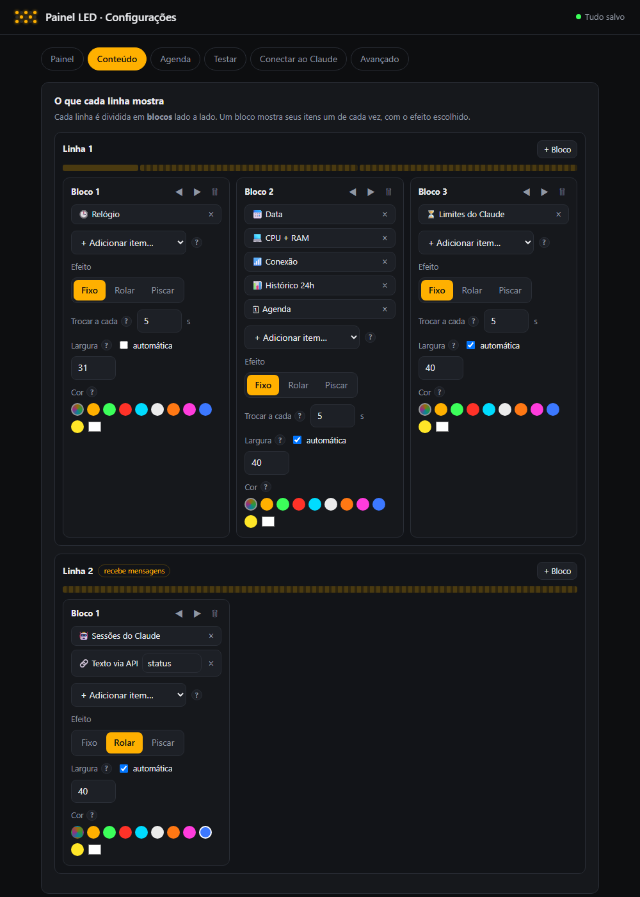
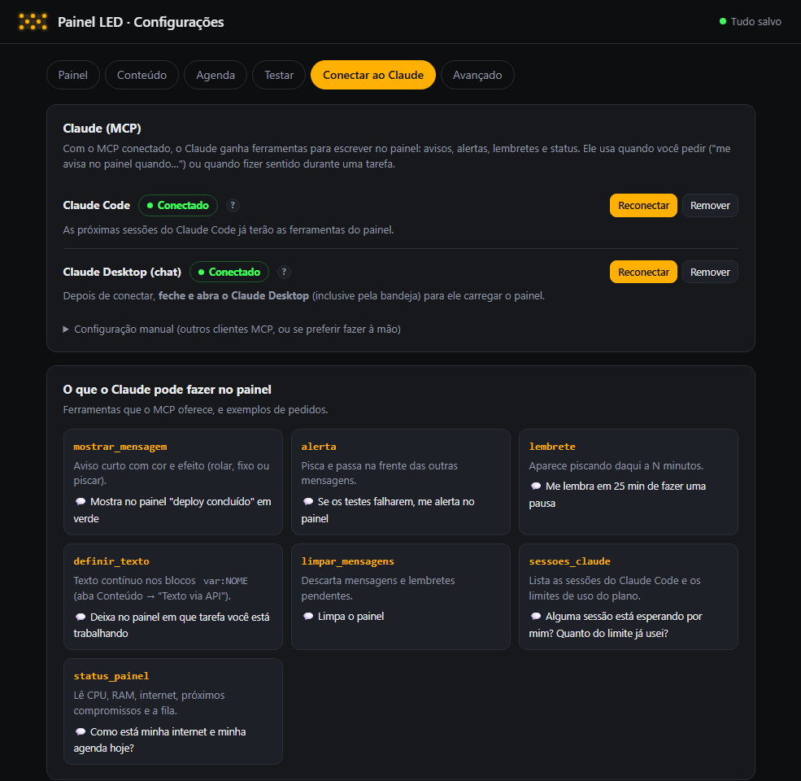
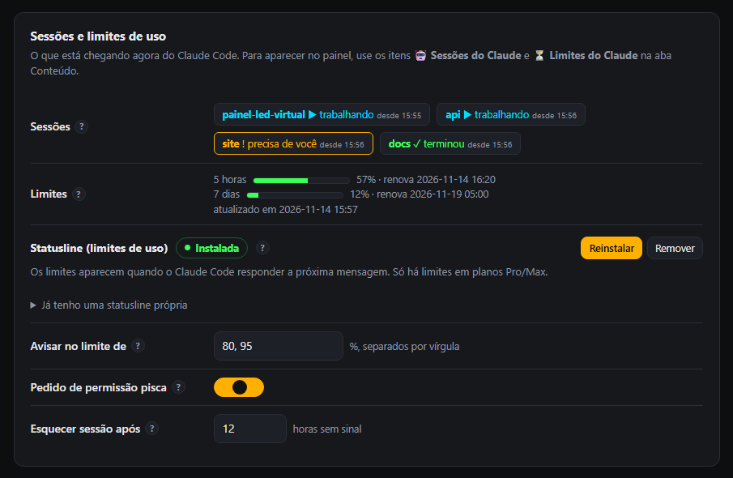

# Painel LED auxiliar

Um letreiro de LED virtual que fica sempre por cima das outras janelas. Ele mostra:
- hora, data, CPU, RAM e a estabilidade da internet;
- seus compromissos do Google Agenda;
- o que as sessões do Claude Code estão fazendo, incluindo os limites de uso do plano.

Também recebe mensagens do Claude via MCP e de qualquer script por HTTP.



Quando uma sessão do Claude Code pede permissão, o aviso pisca e passa na frente de tudo:


É escrito em Rust e desenha em software (winit + softbuffer, sem GPU). Usa uns 12 MB de memória privada e quase nada de CPU quando o texto está parado.

Por enquanto roda no Windows. O código de inicialização automática já cobre Linux e macOS, mas o empacotamento para eles ainda não foi feito.

## Instalação (Windows)

Precisa do [Rust](https://rustup.rs) 1.85 ou mais novo (edição 2024) e das Build Tools do Visual Studio.

```powershell
git clone git@github.com:berlotto/painel-led-auxiliar.git
cd painel-led-auxiliar
pwsh -File install.ps1
```

O script:
1. compila;
2. copia `painel-led.exe` e `painel-led-mcp.exe` para `%LOCALAPPDATA%\Programs\painel-led`;
3. registra o MCP no Claude Code e no Claude Desktop;
4. abre o painel.

Antes de mexer no `claude_desktop_config.json`, ele faz uma cópia `.bak-painel-led`.

- Para só atualizar os executáveis, sem tocar na configuração do Claude: `pwsh -File install.ps1 -SemMcp`.
- Para desenvolver: `cargo run --release`.

## Uso

| Ação | Como |
|---|---|
| Mover | clique e arraste |
| Abrir as configurações | clique direito no painel, ou pelo ícone na bandeja |
| Descartar as mensagens | duplo clique |
| Fechar | o `×` que aparece no canto ao passar o mouse, ou Sair na bandeja |

O ícone na bandeja tem: Configurações, Mostrar/Ocultar, Limpar mensagens, Iniciar com o Windows, Editar arquivo de configuração e Sair.

Se você soltar o painel em outro monitor, ele recalcula a largura para esse monitor.

## Configurações

A tela de configurações é servida pelo próprio painel em `http://127.0.0.1:7878/config` e abre numa janela própria do Edge. Toda opção tem uma explicação no `?`, e as mudanças aparecem no painel na hora.



Na aba Conteúdo você monta cada linha em blocos lado a lado. Cada bloco mostra seus itens um de cada vez, com efeito fixo, rolando ou piscando:



| Item | Mostra |
|---|---|
| `relogio` | HH:MM, com os dois pontos piscando |
| `data` | dia da semana e data |
| `sistema`, `cpu`, `ram` | uso, com a cor pela carga |
| `rede` | latência atual ou `OFFLINE` |
| `historico` | 24 h de conexão em 48 colunas de 30 min |
| `agenda` | até 3 próximos compromissos |
| `sessoes` | sessões do Claude Code: ▶ trabalhando, `!` precisa de você, ✓ terminou |
| `limites` | uso do plano do Claude nas janelas de 5 h e 7 dias |
| `texto:...` | um texto fixo seu |
| `var:nome` | texto que scripts ou o Claude definem pela API |

No efeito fixo, um texto que não cabe no bloco rola. O item `limites` se adapta antes de rolar: se faltar espaço, tira as barrinhas e depois o horário de renovação.

Tudo fica em `%APPDATA%\painel-led\config.toml`, e dá para editar o arquivo à mão. O painel recarrega ao salvar. Se houver erro de sintaxe, mostra o erro piscando e continua com a configuração anterior.

```toml
[painel]
largura = "85%"        # "100%" = monitor inteiro, ou pixels: "900"
linhas = 2
tamanho_led = 6
posicao = "livre"      # "topo", "base" ou "livre"
linha_mensagens = 2    # onde aparecem os avisos do Claude, da agenda e da API

[[linha]]
blocos = [
  { itens = ["relogio"], largura = 31 },
  { itens = ["data", "sistema", "rede", "historico", "agenda"], efeito = "fixo", segundos = 5 },
  { itens = ["limites"] },
]

[[linha]]
blocos = [{ itens = ["sessoes", "var:status"], efeito = "rolar" }]

[agenda]
urls = ["https://calendar.google.com/calendar/ical/.../basic.ics"]
avisar_minutos = [10, 0]

[claude]
avisar_limite = [80, 95]
piscar_permissao = true
esquecer_horas = 12
```

### Google Agenda

No Google Agenda, abra Configurações, escolha a agenda e copie o **Endereço secreto no formato iCal**. Cole na aba Agenda. Também aceita `webcal://` e o caminho de um arquivo `.ics`.

Eventos recorrentes, exceções e cancelamentos são tratados. Os avisos:
- dez minutos antes de cada compromisso, `EM 10 MIN: ...` em laranja;
- na hora, `AGORA: ...` em vermelho.

### Internet

Não há teste de velocidade. A cada 30 s o painel abre uma conexão TCP com 1.1.1.1 e 8.8.8.8 para saber se está online e qual a latência. Ele guarda as últimas 24 h em `%APPDATA%\painel-led\pings.json`.

## Claude

A aba Conectar ao Claude faz toda a ligação com um clique e mostra o estado de cada parte. Ela também traz a configuração manual para quem preferir.



### MCP

`painel-led-mcp.exe` é um servidor MCP via stdio. Se o painel estiver fechado, ele abre. As ferramentas:

| Ferramenta | Exemplo de pedido |
|---|---|
| `mostrar_mensagem` | "mostra no painel 'deploy concluído' em verde" |
| `alerta` | "se os testes falharem, me alerta no painel" |
| `lembrete` | "me lembra em 25 min de fazer uma pausa" |
| `definir_texto` | "deixa no painel em que tarefa você está" |
| `limpar_mensagens` | "limpa o painel" |
| `sessoes_claude` | "alguma sessão está esperando por mim? quanto do limite já usei?" |
| `status_painel` | "como está minha internet e minha agenda hoje?" |

Registro manual no Claude Code:

```
claude mcp add painel-led -s user -- %LOCALAPPDATA%\Programs\painel-led\painel-led-mcp.exe
```

### Sessões, avisos e limites

São dois mecanismos do próprio Claude Code, que a aba instala em `~/.claude/settings.json` (com backup).

**Hooks.** Avisam o painel quando uma sessão abre, recebe um pedido, usa uma ferramenta, pede permissão, termina ou fecha. Daí saem o item `sessoes` e os avisos:
- pedido de permissão pisca em âmbar;
- término aparece em verde.

**Statusline.** Recebe do Claude Code o uso do plano (`rate_limits`, janelas de 5 h e 7 dias) e repassa ao painel.
- No terminal ela mostra `Opus 5.5 · contexto 19% · 5h 53% (renova 16:20) · 7d 12%`.
- O painel pisca um aviso quando o uso passa de 80% e de 95%.



Limitações:

- Limites só existem em planos Pro e Max, e só chegam enquanto alguma sessão do Claude Code está ativa. Com tudo fechado, o painel mostra o último valor recebido.
- O chat do Claude Desktop e o claude.ai não têm hooks nem statusline, então essas conversas não aparecem.
- Se você já usa uma statusline própria, a aba não a substitui e mostra duas linhas para acrescentar ao seu script.

Os hooks nunca travam o Claude:
- com o painel aberto, levam cerca de 0,1 s;
- com ele fechado, o `curl` desiste em 0,3 s e o comando termina com sucesso.

O hook de uso de ferramenta roda a cada ferramenta, então são esses 0,1 s a mais por chamada.

Exemplo da configuração: [`hooks/claude-code-settings.json`](hooks/claude-code-settings.json).

## API local

O painel escuta em `127.0.0.1:7878`. É o mesmo caminho que o MCP e os hooks usam.

| Rota | Uso |
|---|---|
| `POST /mensagem` | Texto puro, ou JSON com `texto`, `cor`, `efeito` (`rolar`, `fixo`, `piscar`), `repetir`, `segundos` e `em_minutos` (vira lembrete). Os campos também podem ir na URL. |
| `POST /texto?nome=X` | Define o texto dos blocos `var:X`. Corpo vazio apaga. |
| `POST /limpar` | Descarta mensagens e lembretes. |
| `GET /status` | CPU, RAM, conexão, agenda, fila e Claude, em JSON. |
| `GET /claude` | Sessões do Claude Code e limites de uso. |
| `POST /claude-hook` | Entrada dos hooks do Claude Code. |
| `POST /claude-statusline` | Entrada da statusline; responde a linha do terminal. |

```bash
curl -X POST "http://127.0.0.1:7878/mensagem?efeito=piscar" --data "Servidor fora do ar"
curl -X POST "http://127.0.0.1:7878/texto?nome=status&cor=verde" --data "BUILD OK"
curl -X POST http://127.0.0.1:7878/mensagem -H "Content-Type: application/json" -d '{"texto": "Alongar", "em_minutos": 30}'
```

Cores: `verde`, `ambar`, `vermelho`, `ciano`, `branco`, `laranja`, `rosa`, `azul`, `amarelo` ou `#rrggbb`.

A API só aceita chamadas da própria máquina:
- pedidos com `Origin` ou `Host` de fora (um site aberto no navegador, por exemplo) recebem 403;
- as rotas que alteram a configuração exigem um token gerado a cada execução, que só a tela de configurações recebe.

## Estrutura

```
src/main.rs           janela, desenho dos LEDs, bandeja, mouse
src/render.rs         monta cada quadro a partir da configuração e do estado
src/font.rs           fonte 5x7 com acentos
src/sources.rs        CPU/RAM, pings, servidor HTTP
src/agenda.rs         leitura de iCal, recorrência, avisos
src/claude.rs         sessões (hooks) e limites (statusline)
src/integrations.rs   ligar e desligar MCP, hooks e statusline
src/autostart.rs      iniciar com Windows, Linux ou macOS
src/ui/config.html    tela de configurações
src/bin/painel-led-mcp.rs   servidor MCP
```

`cargo test` roda os testes do parser de configuração, da agenda e do rastreamento de sessões e limites.

## Licença

MIT. Veja [LICENSE](LICENSE).
